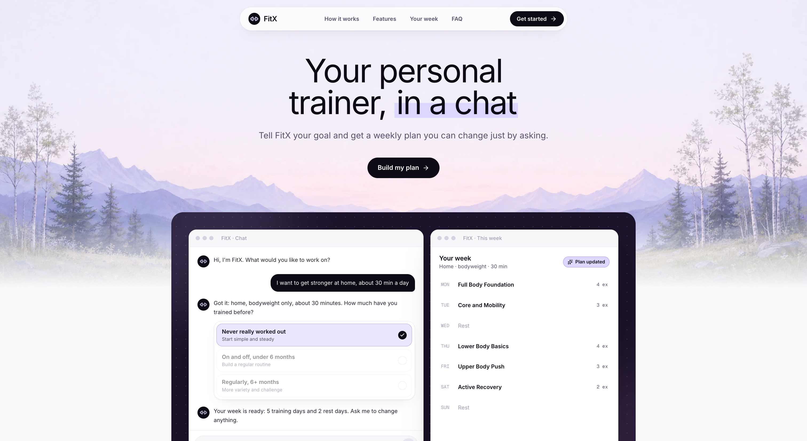

<h1 align="center">FitX</h1>

<p align="center">
  <strong>Your personal trainer, in a chat.</strong><br />
  Tell FitX your goal and get a weekly plan you can change just by asking.
</p>

<p align="center">
  
</p>

## Features

- **AI trainer chat:** describe your goal, equipment, and available time, and the agent builds a plan for you.
- **Weekly workout plans:** training and rest days, each with a set of exercises.
- **Change your plan by asking:** swap exercises, move days, or adjust difficulty in plain language.
- **Exercise tracking:** mark exercises as done and log your progress.
- **Video guides:** embedded YouTube demos for each exercise.
- **Long-term memory:** FitX remembers your preferences and history across sessions.
- **Sign in** with email and password or Google.

## Tech stack

| Layer    | Tech                                                                 |
| -------- | -------------------------------------------------------------------- |
| Frontend | React 19, TypeScript, Vite, Tailwind CSS                             |
| Backend  | Express 5, TypeScript, Knex, Objection.js, Zod                       |
| AI       | OpenAI Agents SDK, with OpenAI or Google Gemini (via the AI SDK)     |
| Database | PostgreSQL                                                           |

## Project structure

```
FitX/
├── api/                  # Express API: agents, tools, routes, DB models and migrations
├── ui/                   # React + Vite frontend
├── docker-compose.yml    # Local API and PostgreSQL services
└── postgresql/data/      # Local PostgreSQL data created by Docker (git-ignored)
```

## Getting started

### Prerequisites

- Node.js 22+
- pnpm 10+ (`corepack enable` if it is not already installed)
- Docker Desktop with Docker Compose

### Environment setup

Create the local environment files:

```bash
cp api/.env.example api/.env
cp ui/.env.example ui/.env
```

Then fill in `api/.env`:

| Variable           | Description                                                     |
| ------------------ | --------------------------------------------------------------- |
| `JWT_SECRET`       | A long random secret                                            |
| `AI_PROVIDER`      | `openai` or `gemini`                                            |
| `OPENAI_API_KEY`   | OpenAI API key (the memory agent uses OpenAI with either provider) |
| `GEMINI_API_KEY`   | Required when `AI_PROVIDER=gemini`                              |
| `YOUTUBE_API_KEY`  | YouTube Data API v3 key for exercise video guides               |
| `GOOGLE_CLIENT_ID` | Optional. OAuth 2.0 Web client ID for Google sign-in            |

For Google sign-in, set `VITE_GOOGLE_CLIENT_ID` in `ui/.env` to the same client ID.

The example database values work with the local Docker PostgreSQL service.
Docker sets `POSTGRES_HOST` to `db` for the API container. `localhost` is
still correct when you run the API directly on your machine.

### Run with Docker (recommended)

Docker runs the API and PostgreSQL. Run the UI separately for hot reload.

```bash
docker compose up --build
```

In another terminal:

```bash
cd ui
pnpm install
pnpm dev
```

Open:

- UI: http://localhost:5173
- API: http://localhost:8080/api/v1

The API runs database migrations and seeds automatically on startup.

To stop the services:

```bash
docker compose down
```

> [!NOTE]
> PostgreSQL data persists in `postgresql/data/`. `docker compose down -v` does
> **not** delete this bind-mounted directory. Delete it by hand only if you want
> to reset all local data.

### Run without Docker

Start PostgreSQL yourself and point the `POSTGRES_*` values in `api/.env` at it. Then:

```bash
cd api
pnpm install
pnpm dev
```

In another terminal:

```bash
cd ui
pnpm install
pnpm dev
```

## Build and checks

```bash
# API
cd api && pnpm build

# UI
cd ui && pnpm lint && pnpm build
```

## Deployment

See [VERCEL_DEPLOYMENT.md](VERCEL_DEPLOYMENT.md) for deploying to Vercel.
